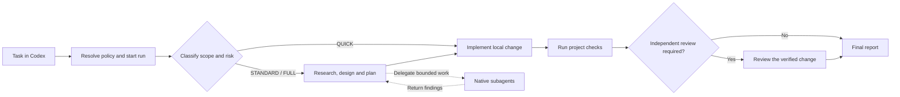

# CodeFlow

**English** · [Русский](README.ru.md)


[](LICENSE)

**A resumable development workflow for coding agents, starting with OpenAI Codex.** Start with one task. CodeFlow chooses the scope, records decisions and results, and verifies changes with your project's actual tests. Small fixes take the short path. Larger work can use independent subagents and leave checkpoints for a later session.

CodeFlow uses native Codex Skills and subagents with a standard-library Python helper. It is an independent project. The repository is named CodeFlow so additional client adapters can fit under the same project. This release supports Codex.

- **QUICK, STANDARD, FULL** adapt the workflow to the scope and risk.
- **Efficiency, performance, speed** select a model, reasoning and delegation policy separately from scope.
- **Status and resume** let you inspect or continue a run from the project directory.

## Install

Requires a local Codex client with Skills, Python 3.10+ and filesystem access to the target project. The local plugin path was tested with Codex CLI 0.170.0.

From a checkout of this repository, register the local marketplace and install the plugin:

```sh
codex plugin marketplace add .
codex plugin add codeflow@codeflow-local
```

For a standalone Skill, run the installer from the CodeFlow checkout:

```sh
python3 scripts/install_skill.py /absolute/path/to/your-project
```

Use one installation method. Then open a new Codex session in the project you want to work on. Invoke `$codeflow:workflow` for the plugin or `$workflow` for the standalone Skill. Choose the actual Skill name from the client picker if it differs.

**Upgrading from CodexFlow:** install the new plugin and use `$codeflow:workflow`. Existing project state and configuration stay in `.codexflow/`, and user configuration stays in `$CODEX_HOME/codexflow/config.json`. You can uninstall the old plugin separately after verifying the new one.

## First run

Enter these as prompts in Codex:

```text
$codeflow:workflow --quick Fix the empty input check and run the relevant tests
$codeflow:workflow Add pagination to the orders list
$codeflow:workflow status
$codeflow:workflow resume <run-id>
```

| Profile | Main request | Review and delegation |
|---|---|---|
| `efficiency` (default) | Sol / medium | Luna for focused tasks, review by risk |
| `performance` | Astra / xhigh | Parallel independent work, required Sol review |
| `speed` | Sol / low | Luna / low, independent tasks can run in parallel |

All profiles run necessary checks. The profile requests a model and reasoning level. The Codex client controls the active session, so use its model picker when switching the main model. Newer compatible Sol, Luna and explicitly enabled Astra versions can be selected from the native catalog. Catalog presence alone does not establish account access.

```text
$codeflow:workflow --profile speed --set max_subagents=1 Update the parser tests
$codeflow:workflow config --save --set roles.review_model.reasoning_effort="high"
$codeflow:workflow config --global --save --profile efficiency
```

Configuration applies from the built-in profile to user settings, project settings and finally run overrides. Read the [configuration reference](plugins/codeflow/skills/workflow/references/profiles.md) for file locations and all settings.

## How it works



Run state lives in `.codexflow/runs/<run-id>/`. QUICK groups related checkpoints, and skipped stages keep their reasons in state. Resume restores the recorded policy and progress, then checks the current files before continuing. The Skill can use native usage figures when the client exposes them. Token savings against plain Codex have not been established.

## Diagnostics, recovery and usage

```text
$codeflow:workflow doctor
$codeflow:workflow --series Check and update the four notebooks independently
$codeflow:workflow status <run-id>
$codeflow:workflow usage enable
$codeflow:workflow usage show <run-id>
```

Project checks record real exit codes, elapsed time and watched-file fingerprints. Resume checks whether saved evidence is still current. Start with targeted checks and use the full suite when the project or risk requires it. Series mode keeps separate evidence for each item and its dependencies.

Usage is opt-in per project. Approve the native hooks in a supported Codex client after enabling it. The hook stores numeric usage locally for linked requests. Coverage may be partial, and the figures do not represent remaining plan quota. See [run evidence and recovery](plugins/codeflow/skills/workflow/references/journal.md).

## Documentation

| Guide | What it covers |
|---|---|
| [Architecture](docs/architecture.md) | Stage map, model selection, state and failure recovery |
| [Configuration](plugins/codeflow/skills/workflow/references/profiles.md) | Profiles, per-role settings and precedence |
| [Compatibility research](docs/research.md) | Original design and Codex references |
| [Validation](docs/validation.md) | Automated checks, real runs and benchmark limits |
| [Changelog](CHANGELOG.md) | Version history |
| [Contributing](CONTRIBUTING.md) · [Security](SECURITY.md) | Changes and vulnerability reporting |
| [Releasing](docs/releasing.md) | Tags, package verification and GitHub release drafts |

```sh
python3 -m unittest discover -s tests -v
python3 scripts/validate_package.py
```

[MIT License](LICENSE)
