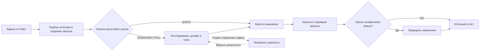

# CodexFlow

[English](README.md) · **Русский**


[](LICENSE)

**Workflow для OpenAI Codex с сохранением прогресса.** Передайте задачу, и CodexFlow подберёт глубину работы, сохранит результаты и запустит реальные проверки проекта. Небольшие правки идут коротким путём. Для больших задач можно подключить независимых субагентов и продолжить работу с сохранённого этапа.

Это независимый проект. Он использует нативные Skills, субагентов Codex и скрипт на стандартной библиотеке Python.

- **QUICK, STANDARD, FULL** задают глубину работы по масштабу и риску.
- **Efficiency, performance, speed** отдельно настраивают модели, reasoning и делегирование.
- **Status и resume** показывают прогресс и продолжают запуск в папке проекта.

## Установка

Нужны локальный клиент Codex с поддержкой Skills, Python 3.10+ и доступ к файлам проекта. Установка локального плагина проверена на Codex CLI 0.170.0.

В папке этого репозитория зарегистрируйте локальный marketplace и установите плагин:

```sh
codex plugin marketplace add .
codex plugin add codexflow@codexflow-local
```

Для отдельного Skill запустите установщик из папки CodexFlow:

```sh
python3 scripts/install_skill.py /absolute/path/to/your-project
```

Выберите один вариант установки. Откройте новую сессию Codex в целевом проекте. Для плагина используйте `$codexflow:workflow`, для отдельного Skill — `$workflow`. Если имя отличается, выберите навык в меню клиента.

## Первый запуск

Введите в чате Codex:

```text
$codexflow:workflow --quick Исправь проверку пустого ввода и запусти тесты
$codexflow:workflow Добавь пагинацию в список заказов
$codexflow:workflow status
$codexflow:workflow resume <run-id>
```

| Профиль | Запрос для главного агента | Ревью и делегирование |
|---|---|---|
| `efficiency` (по умолчанию) | Sol / medium | Luna для отдельных задач, ревью по риску |
| `performance` | Astra / xhigh | Независимая работа параллельно, обязательное ревью на Sol |
| `speed` | Sol / low | Luna / low, независимые задачи могут идти параллельно |

Во всех профилях выполняются необходимые проверки. Профиль задаёт желаемую модель и reasoning, а активной сессией управляет клиент Codex. При смене главной модели используйте его меню выбора. Плагин может выбрать более свежие совместимые версии Sol, Luna и явно разрешённой Astra из нативного каталога. Доступность модели в каталоге сама по себе не подтверждает доступ аккаунта.

```text
$codexflow:workflow --profile speed --set max_subagents=1 Обнови тесты парсера
$codexflow:workflow config --save --set roles.review_model.reasoning_effort="high"
$codexflow:workflow config --global --save --profile efficiency
```

Приоритет настроек растёт от встроенного профиля к пользовательскому файлу, проектному файлу и параметрам запуска. Пути и полный список параметров есть в [справочнике конфигурации](plugins/codexflow/skills/workflow/references/profiles.ru.md).

## Как это работает



Состояние хранится в `.codexflow/runs/<run-id>/`. QUICK записывает несколько этапов вместе, а причины пропусков сохраняет в состоянии. При продолжении плагин восстанавливает записанные настройки и прогресс, затем сверяет их с текущими файлами. Расход токенов можно указать, когда клиент его сообщает. Экономия токенов по сравнению с обычным Codex пока не установлена.

## Документация

| Раздел | Что внутри |
|---|---|
| [Архитектура](docs/architecture.ru.md) | Этапы, выбор моделей, состояние и восстановление |
| [Конфигурация](plugins/codexflow/skills/workflow/references/profiles.ru.md) | Профили, настройки ролей и приоритеты |
| [Совместимость](docs/research.ru.md) | Исходные решения и ссылки на Codex |
| [Проверки](docs/validation.ru.md) | Автотесты, реальные запуски и пределы сравнения |
| [История изменений](CHANGELOG.ru.md) | Что появилось в каждой версии |
| [Участие в проекте](CONTRIBUTING.ru.md) · [Безопасность](SECURITY.ru.md) | Изменения и сообщения об уязвимостях |
| [Подготовка релиза](docs/releasing.ru.md) | Теги, проверка пакета и черновики GitHub Releases |

```sh
python3 -m unittest discover -s tests -v
python3 scripts/validate_package.py
```

[Лицензия MIT](LICENSE)
