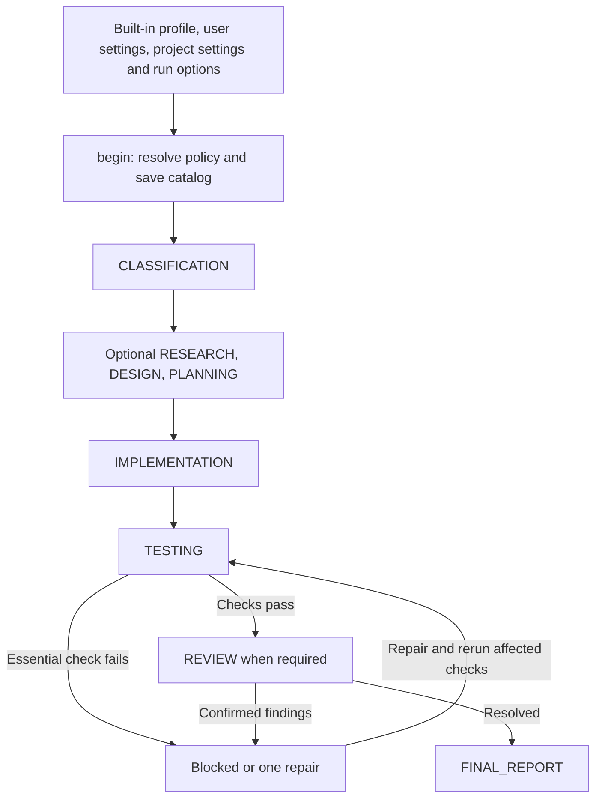

# Architecture

**English** · [Русский](architecture.ru.md) · [Home](../README.md)

Codex runs the workflow. The [Skill](../plugins/codexflow/skills/workflow/SKILL.md) defines agent behavior. The Python helper handles model policy and local state. It reads the native catalog through `codex debug models` and never starts a model session.

| Component | Responsibility |
|---|---|
| [Plugin manifest](../plugins/codexflow/.codex-plugin/plugin.json) | Distribution and Skill discovery |
| [Skill](../plugins/codexflow/skills/workflow/SKILL.md) | Classification, sequencing, delegation and check selection |
| [Policy and state helper](../plugins/codexflow/skills/workflow/scripts/flow.py) | Layered configuration, model resolution, locked writes and recovery |
| [Stage reference](../plugins/codexflow/skills/workflow/references/pipeline.md) | Inputs, results and skip rules for each stage |
| [Agent contracts](../plugins/codexflow/skills/workflow/references/agents.md) | Research, design and review handoffs |

**QUICK** groups classification and early skips in a single record. Short checks allow implementation, checks and completion to be recorded together. Write an implementation checkpoint before long checks. **STANDARD** adds focused research and planning. **FULL** retains explicit stage checkpoints, with delegation where it helps. An essential check failure blocks dependent stages. Required independent review also blocks if a reviewer is unavailable.

## Model selection

The profile and layered settings select an approved candidate for each role. In automatic mode, one catalog snapshot per new run supplies visible candidates and supported reasoning levels. Role selection considers the model family, configured baseline and available runtime evidence. The client controls the main session model. The report distinguishes requested and verified models.

## State and recovery

`task.md` holds the task. `state.json` records a run ID, timestamps, the effective policy, stages, revision and repair count. `model-catalog.json` contains the filtered snapshot created by `begin`. Completed stages have artifacts such as `test-report.md`. A skipped stage has either a short explanation in state or an artifact.

Writes use a per-run lock and revision check. A batch validates every entry before writing and commits state after the artifacts. If a process stops mid-write, artifacts newer than state require inspection. Resume continues the first pending stage and checks the real working tree. It cannot recreate a context window or undo changes. After a process crash, remove a stale lock only after confirming that no writer is active.

## Boundaries

The project uses native Codex tooling and standard-library Python. Skill instructions govern delegation and checks. The runtime helper enforces workflow transitions and model-policy decisions with the evidence it receives. It has no independent account entitlement, pricing or exact token meter. Read-only child instructions do not replace the host sandbox. Review status describes work actually performed.
