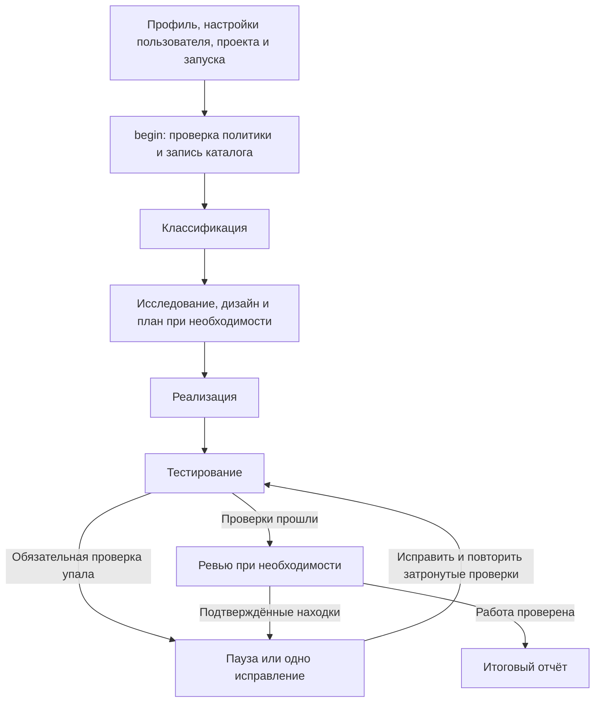

# Архитектура

[English](architecture.md) · **Русский** · [Главная](../README.ru.md)

Workflow ведёт Codex. [Skill](../plugins/codeflow/skills/workflow/SKILL.ru.md) задаёт правила работы агента, а скрипт на Python проверяет политику моделей и записывает состояние. Скрипт читает нативный каталог через `codex debug models`. Для этого отдельная модельная сессия не нужна.

| Компонент | Назначение |
|---|---|
| [Манифест](../plugins/codeflow/.codex-plugin/plugin.json) | Установка и обнаружение Skill |
| [Skill](../plugins/codeflow/skills/workflow/SKILL.ru.md) | Оценка задачи, порядок работы, делегирование и выбор проверок |
| [Скрипт состояния](../plugins/codeflow/skills/workflow/scripts/flow.py) | Приоритеты конфигурации, модели, запись с блокировкой и восстановление |
| [Справочник этапов](../plugins/codeflow/skills/workflow/references/pipeline.ru.md) | Входные данные, результаты и пропуски |
| [Роли агентов](../plugins/codeflow/skills/workflow/references/agents.ru.md) | Задания для исследования, дизайна и ревью |

**QUICK** сохраняет классификацию и ранние пропуски вместе. После короткой проверки можно сразу записать реализацию, результаты тестов и итог. Перед длинной проверкой лучше сохранить реализацию отдельной записью. **STANDARD** добавляет целевое исследование и план. **FULL** фиксирует результаты этапов с выборочным делегированием. Падение обязательного теста блокирует зависимые этапы. Если независимое ревью обязательно, а проверяющий недоступен, запуск тоже блокируется.

## Выбор модели

Профиль и настройки задают допустимые модели для каждой роли. В автоматическом режиме новый запуск читает один снимок каталога с видимыми моделями и уровнями reasoning. При подборе учитываются семейство, базовая версия и реальные сведения клиента. Главную сессию настраивает клиент. В отчёте различаются запрошенная и подтверждённая модели.

## Состояние и восстановление

В `task.md` хранится задача, а в `state.json` — ID, время, действующие настройки, этапы, ревизия и число попыток исправления. `model-catalog.json` хранит отфильтрованный снимок из `begin`. Завершённые этапы оставляют файлы вроде `test-report.md`. Причина пропуска хранится в состоянии или в артефакте.

Запись использует блокировку и сверку ревизии. Пакет проверяется целиком, затем записываются артефакты и состояние. После прерывания новые файлы без подтверждения в состоянии нужно сверить с результатом. Resume продолжает первый незавершённый этап после проверки рабочих файлов. Команда не восстанавливает окно контекста и не отменяет правки. Оставшуюся после сбоя блокировку можно снять после проверки, что активного процесса записи нет.

## Журнал и серия задач

В `journal.json` хранятся выполненные проверки, события нативных агентов и элементы серии. У каждой проверки есть код выхода, время, путь к логу и отпечатки входных файлов. Зависимые элементы запоминают ID проверки, на которой основан результат. Изменение файла или новая проверка зависимости делает связанный результат устаревшим. [Справочник журнала](../plugins/codeflow/skills/workflow/references/journal.ru.md) объясняет, как открыть проверку повторно, сохранив реализацию и счётчик исправлений.

Опциональные хуки Codex отдельно записывают числовую статистику связанного запуска. Отчёт различает частичные данные и неизвестный расход.

## Ограничения

Проект использует инструменты Codex и стандартную библиотеку Python. Skill задаёт правила делегирования и проверок. Скрипт проверяет переходы и модельную политику по доступным сведениям. У него нет собственного доступа к тарифам, правам аккаунта и точной статистике токенов. Указание субагенту работать только на чтение не заменяет системный sandbox. Статус ревью отражает фактически выполненную проверку.
